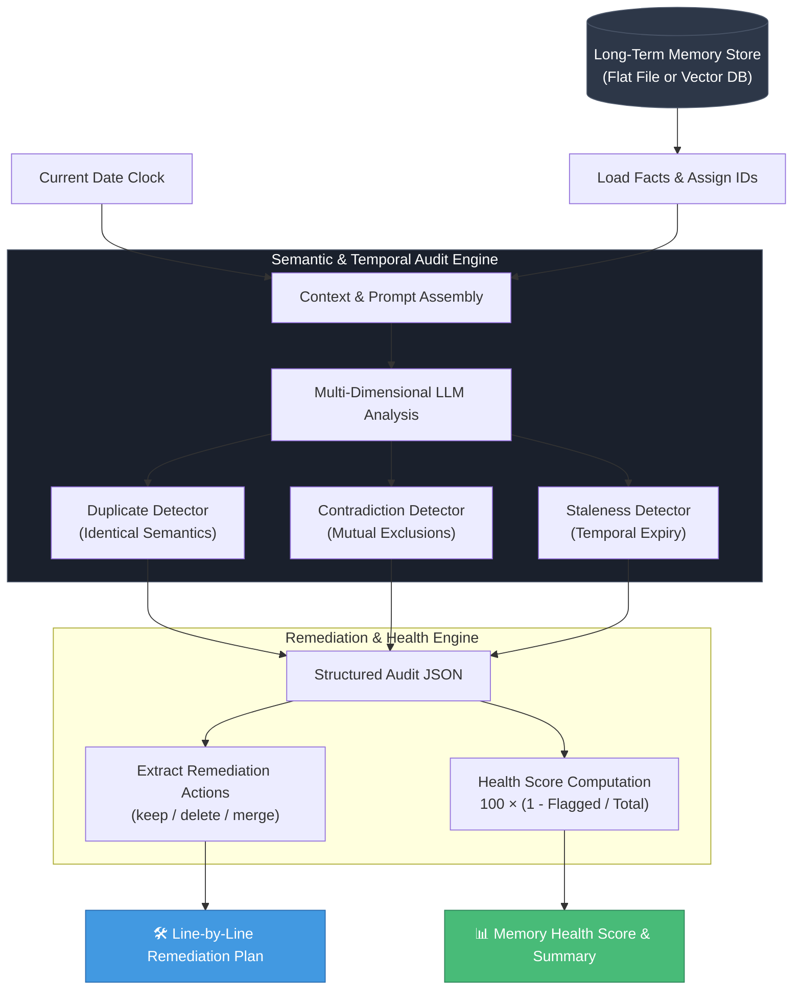

# POC 02: Long-Term Memory Rot Auditor

> A temporal and semantic hygiene auditor for AI assistant long-term memory stores that detects factual contradictions, duplicates, and temporal staleness, producing actionable remediation plans and health scores.

---

## 📌 Problem Statement

Stateful AI agents and assistants persist user facts across sessions in long-term memory stores (vector databases, graph stores, or flat-file notes). Over weeks and months, these memories degrade due to **Memory Rot**:
1. **Contradictions:** As real-world states shift (e.g., `"User lives in Pune (2022)"` vs. `"User lives in Bangalore (2024)"`, or dietary changes), agents hold conflicting world states simultaneously.
2. **Semantic Redundancies:** Paraphrased facts accumulate (e.g., `"User likes Python"` and `"User's favorite language is Python"`), cluttering context windows and driving up token costs.
3. **Temporal Staleness:** Ephemeral facts become obsolete (e.g., `"User is preparing for exam in Feb 2023"`), but agents continue to reason as if past events are current.

---

## 🏗️ Architecture



---

## ⚙️ How It Works

1. **Memory Ingestion:** Ingests long-term memory lines either from built-in sample memory or a custom text file (`one fact per line`).
2. **Temporal Grounding:** Injects the current system date (`date.today()`) into the LLM prompt to ground temporal reasoning against relative and absolute timestamps.
3. **Multi-Class Defect Detection:**
   - **`duplicate`**: Facts expressing identical semantic knowledge with different wording.
   - **`contradiction`**: Mutually exclusive statements (e.g., vegetarian vs. eats meat, multiple current residencies).
   - **`stale`**: Events with elapsed dates, expired milestones, or outdated job statuses.
4. **Remediation Directives:** For every flagged issue, the auditor determines a targeted corrective action:
   - `keep <id>` / `delete <id>`
   - `merge <id1, id2>`
5. **Memory Health Scoring:**
   $$\text{Health Score} = 100 \times \left(1 - \frac{|\text{Flagged Entries}|}{\max(|\text{Total Entries}|, 1)}\right)$$

---

## 🚀 Getting Started

### Prerequisites

Ensure you have your environment configured in the root `.env`:
```bash
GROQ_API_KEY=your_groq_api_key_here
# or
ANTHROPIC_API_KEY=your_anthropic_api_key_here
```

### Running the Script

```bash
# Audit the built-in sample memory dataset
python memory_auditor.py

# Audit your own memory file (one fact per line)
python memory_auditor.py my_agent_memories.txt
```

---

## 📊 Example Output

```text
Audited 8 memories, found 4 issue(s).

1. [CONTRADICTION] User cannot live in both Pune and Bangalore simultaneously as primary residence.
     #0: User lives in Pune (noted 2022-03-10)
     #1: User lives in Bangalore (noted 2024-08-02)
   Suggested: keep 1 / delete 0

2. [DUPLICATE] Both entries assert that the user prefers Python.
     #2: User likes Python
     #3: User's favorite language is Python
   Suggested: keep 3 / delete 2

3. [STALE] February 2023 has already passed.
     #4: User is preparing for the GATE exam in Feb 2023
   Suggested: delete 4

4. [CONTRADICTION] Being strictly vegetarian contradicts eating chicken on weekends.
     #5: User is vegetarian
     #6: User eats chicken on weekends
   Suggested: merge

Memory health score: 25% (6/8 entries flagged)
```
