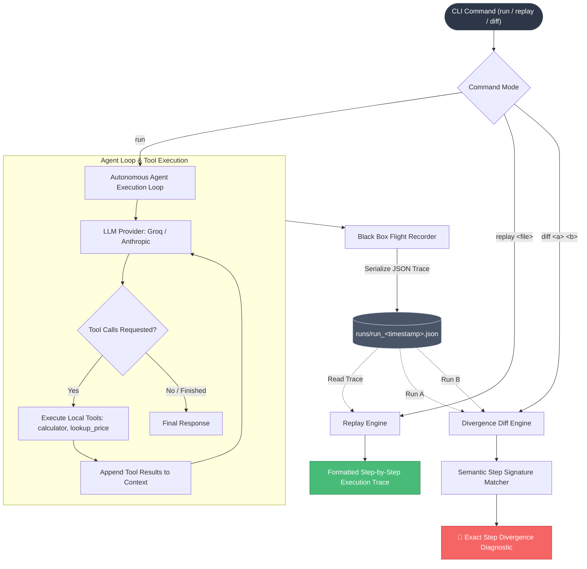

# POC 03: Agent Black Box Recorder

> An execution trace recording, deterministic replay, and behavioral diff engine for tool-calling autonomous AI agents.

---

## 📌 Problem Statement

Autonomous agents that utilize external tools are notoriously hard to debug in production environments:
1. **Non-Deterministic Divergence:** Two runs of the exact same user prompt can take different reasoning paths or invoke different tools.
2. **Silent Failure Cascades:** A tool returns an unexpected string format, and the agent continues for several subsequent turns before hallucinating or failing silently.
3. **Lack of Auditability:** Without an immutable flight recorder, engineering teams cannot reproduce agent incidents or verify whether a prompt optimization broke existing tool workflows.

---

## 🏗️ Architecture



---

## ⚙️ How It Works

### 1. Recording (`run`)
- Executes the agent against provided task prompts up to a configured `MAX_STEPS` threshold.
- Intercepts each model step (text generated, tool calls requested) and tool response (tool name, parsed input parameters, tool output).
- Saves the complete session to disk as a timestamped JSON trace in `runs/run_<timestamp>.json`:
  ```json
  {
    "task": "What is the total cost of 3 laptops and 2 pens?",
    "steps": [
      {
        "type": "model",
        "text": "",
        "tool_calls": [{"name": "lookup_price", "input": {"item": "laptop"}}]
      },
      {
        "type": "tool",
        "name": "lookup_price",
        "input": {"item": "laptop"},
        "output": "900"
      }
    ]
  }
  ```

### 2. Replay (`replay`)
- Parses a recorded JSON run trace and produces an annotated timeline showing exact model intents, parameters passed to each tool, tool outputs, and failure flags (`<-- FAILED`).

### 3. Trace Diffing (`diff`)
- Compares two separate runs step-by-step using a normalized **Semantic Signature**:
  - Model steps are compared by their structured tool calls.
  - Tool steps are compared by tool name, input arguments, and execution outputs.
- Pinpoints the **exact step index** where reasoning or execution diverged.

---

## 🚀 Getting Started

### Prerequisites

Ensure you have your environment configured in the root `.env`:
```bash
GROQ_API_KEY=your_groq_api_key_here
# or
ANTHROPIC_API_KEY=your_anthropic_api_key_here
```

### Running the Script

```bash
# 1. Record a new agent execution
python blackbox.py run "What is the total cost of 3 laptops and 2 pens?"

# 2. Replay a recorded run trace
python blackbox.py replay runs/run_1791263521.json

# 3. Diff two runs to identify divergence
python blackbox.py diff runs/run_A.json runs/run_B.json
```

---

## 📊 Example Output

### Replay Output
```text
Task: What is the total cost of 3 laptops and 2 pens?

 0. MODEL  said: ''  calls: [lookup_price({'item': 'laptop'}), lookup_price({'item': 'pen'})]
 1. TOOL   lookup_price({'item': 'laptop'}) = 900
 2. TOOL   lookup_price({'item': 'pen'}) = 1
 3. MODEL  said: ''  calls: [calculator({'expression': '3*900 + 2*1'})]
 4. TOOL   calculator({'expression': '3*900 + 2*1'}) = 2702
 5. MODEL  said: 'The total cost of 3 laptops and 2 pens is $2,702.'  calls: []
```

### Diff Output (Detecting Divergence)
```text
A task: What is the total cost of 3 laptops and 2 pens?
B task: What is the total cost of 3 laptops and 2 pens?

First divergence at step 3:
  A: MODEL  said: ''  calls: [calculator({'expression': '3*900 + 2*1'})]
  B: MODEL  said: ''  calls: [calculator({'expression': '2700 + 2'})]
```
