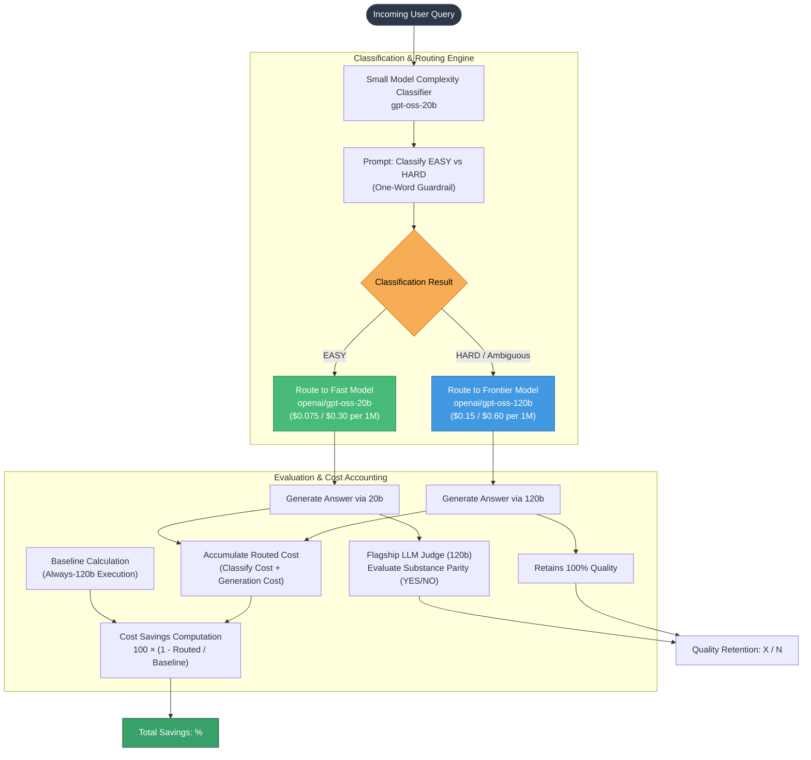

# POC 05: Cost-Aware Model Router

> A tiered LLM query routing pipeline that dynamically classifies incoming queries into complexity tiers, routing easy queries to fast, economical models and hard tasks to frontier models while quantifying cost savings and response quality.

---

## 📌 Problem Statement

In production LLM applications, user traffic exhibits high variance in task complexity:
1. **The Overkill Tax:** Sending basic queries (e.g., unit conversions, factual lookups, simple text formatting) to frontier models (e.g., 120B+ parameter models) burns significant API budget with negligible quality difference.
2. **The Underkill Trap:** Routing everything to small, cheaper models destroys user experience on deep reasoning, complex programming, or multi-step logic.
3. **Overhead Penalty:** Naive classification systems often consume more latency and tokens than they save if not carefully designed.

---

## 🏗️ Architecture



---

## ⚙️ How It Works

1. **Low-Overhead Classification:**
   - A fast, low-cost model (`gpt-oss-20b`) performs single-token classification:
     - **EASY:** Simple factual retrieval, short translation, text formatting, basic unit conversions.
     - **HARD:** Multi-step logical reasoning, coding, mathematical proofs, nuanced semantic analysis.
   - **Fail-Safe Fallback:** If the output is ambiguous or uncertain, the router conservatively defaults to `HARD`.
2. **Dynamic Model Dispatch:**
   - Dispatches the query to the chosen model tier with appropriate completion token limits and reasoning configurations.
3. **Quality Equivalence Verification:**
   - For routed `EASY` queries, the pipeline generates a baseline answer with the frontier model (`120b`) and prompts a judge to test whether the smaller model's response matches the reference in substance.
4. **End-to-End Economic Accounting:**
   - Tracks exact prompt and completion token counts according to provider pricing tables.
   - Strictly accounts for **router classification overhead** as part of the total routed expenditure:
     $$\text{Cost}_{\text{routed}} = \text{Cost}_{\text{classifier}} + \text{Cost}_{\text{model\_generation}}$$
     $$\text{Cost Savings} = 100 \times \left(1 - \frac{\text{Cost}_{\text{routed}}}{\text{Cost}_{\text{baseline}}}\right)$$

---

## 🚀 Getting Started

### Prerequisites

Ensure you have your environment configured in the root `.env`:
```bash
GROQ_API_KEY=your_groq_api_key_here
```

### Running the Script

```bash
python model_router.py
```

---

## 📊 Example Output

```text
#  route  quality  query
1  EASY   OK       What is the capital of Australia?
2  EASY   OK       Convert 5 kilometers to miles.
3  EASY   OK       Give a one-line definition of photosynthesis.
4  EASY   OK       Rewrite this politely: 'Send me the report now.'
5  HARD   OK       A train leaves at 3pm going 60 km/h; another leaves...
6  HARD   OK       Write a Python function that finds the longest palindromic...
7  HARD   OK       Compare the trade-offs between microservices and a monolith...
8  HARD   OK       If all bloops are razzies and some razzies are lazzies...

Always-120b cost : $0.000342
Routed cost      : $0.000218  (includes classifier overhead)
Cost savings     : 36.3%
Quality retained : 8/8 answers as good as 120b
```
