# Weekly POCs: Production-Grade AI Engineering Proof of Concepts

[](https://www.python.org/)
[](https://opensource.org/licenses/MIT)
[](https://console.groq.com)

A curated collection of focused, lightweight, and production-tested Proof of Concepts (POCs) solving critical challenges in building reliable, cost-efficient, and secure LLM applications.

Each POC is self-contained with its own runnable script, isolated architecture diagram, and deep-dive documentation.

---

## 🗺️ System Overview & POC Taxonomy

```mermaid
flowchart TB
    subgraph Reliability ["1. Retrieval & Epistemic Confidence"]
        POC1["01-rag-confidence<br/><b>Disagreement-Based RAG Confidence</b><br/><i>Contradiction detection across chunks & abstention gating</i>"]
    end

    subgraph MemoryHygiene ["2. State & Memory Management"]
        POC2["02-memory-auditor<br/><b>Long-Term Memory Rot Auditor</b><br/><i>Temporal staleness, duplicate purging & contradiction audit</i>"]
    end

    subgraph AgentObservability ["3. Agent Observability & Determinism"]
        POC3["03-blackbox-recorder<br/><b>Agent Black Box Recorder</b><br/><i>Flight recorder JSON traces, step replay & diff divergence detector</i>"]
    end

    subgraph Security ["4. Adversarial Red Teaming & Security"]
        POC4["04-injection-canary<br/><b>Prompt Injection Canary</b><br/><i>Canary trap tokens, tripwire detection & benchmark evaluation</i>"]
    end

    subgraph CostLatency ["5. Economics & Inference Routing"]
        POC5["05-model-router<br/><b>Cost-Aware Model Router</b><br/><i>Query complexity classification, dynamic tier dispatch & cost savings</i>"]
    end

    style POC1 fill:#2b6cb0,stroke:#2c5282,color:#fff
    style POC2 fill:#6b46c1,stroke:#553c9a,color:#fff
    style POC3 fill:#285e61,stroke:#234e52,color:#fff
    style POC4 fill:#9b2c2c,stroke:#742a2a,color:#fff
    style POC5 fill:#2f855a,stroke:#276749,color:#fff
```



---

## 📚 POC Catalog

| # | Directory & POC Name | Core Challenge Addressed | Architectural Pattern | Key Metric / Output |
|---|----------------------|--------------------------|-----------------------|---------------------|
| **01** | [`01-rag-confidence`](file:///c:/Users/Siddharth%20Savant/Documents/POC/01-rag-confidence) | Inconsistent/conflicting documents in RAG knowledge bases | Isolated per-chunk generation + LLM consensus judging | Calibrated Confidence Score & Abstention Gating |
| **02** | [`02-memory-auditor`](file:///c:/Users/Siddharth%20Savant/Documents/POC/02-memory-auditor) | Long-term memory rot, stale timestamps, conflicting facts | Temporal grounding + Multi-class semantic defect analysis | Memory Health Score % & Actionable Cleanup Plan |
| **03** | [`03-blackbox-recorder`](file:///c:/Users/Siddharth%20Savant/Documents/POC/03-blackbox-recorder) | Agent non-determinism & silent multi-turn tool failures | Structured JSON flight recording, replay & diffing | Step-by-step Trace & First-Divergence Point |
| **04** | [`04-injection-canary`](file:///c:/Users/Siddharth%20Savant/Documents/POC/04-injection-canary) | Indirect prompt injection via untrusted third-party data | Dynamic canary tokens + Tripwire tool invocation alerts | Empirical Defense Success Delta (e.g. 0% vs 100%) |
| **05** | [`05-model-router`](file:///c:/Users/Siddharth%20Savant/Documents/POC/05-model-router) | Overspending on frontier models for trivial user tasks | Low-latency complexity classification + Cascading routing | % Cost Savings & Substance Parity Score |

---

## 📁 Repository Structure

```text
weekly_pocs/
├── .env.example                  # Template for required API keys
├── .gitignore                    # Excludes .env, virtual environments, caches
├── requirements.txt              # Core dependencies (groq, anthropic, dotenv, openai)
├── README.md                     # Root project documentation & taxonomy
├── 01-rag-confidence/
│   ├── README.md                 # Architecture, methodology & execution guide
│   └── rag_confidence.py         # Runnable implementation script
├── 02-memory-auditor/
│   ├── README.md                 # Architecture & memory scoring walkthrough
│   └── memory_auditor.py         # Runnable implementation script
├── 03-blackbox-recorder/
│   ├── README.md                 # Architecture, record/replay/diff documentation
│   ├── blackbox.py               # Runnable implementation script
│   └── runs/                     # Example serialized agent execution traces
│       └── run_1791263521.json
├── 04-injection-canary/
│   ├── README.md                 # Threat model, canary mechanics & defense benchmarks
│   └── injection_canary.py       # Runnable implementation script
└── 05-model-router/
    ├── README.md                 # Cost-quality optimization architecture
    └── model_router.py           # Runnable implementation script
```

---

## ⚡ Quickstart

### 1. Clone the Repository
```bash
git clone https://github.com/siddharthharbinger/weekly_pocs.git
cd weekly_pocs
```

### 2. Set Up Virtual Environment & Dependencies
```bash
# Create virtual environment
python -m venv .venv

# Activate environment
# On Windows (PowerShell):
.venv\Scripts\Activate.ps1
# On Linux / macOS:
source .venv/bin/activate

# Install dependencies
pip install -r requirements.txt
```

### 3. Configure API Credentials
Copy `.env.example` to `.env` and configure your API key:
```bash
cp .env.example .env
```

Edit `.env`:
```env
# Groq (Default high-speed inference)
GROQ_API_KEY=gsk_your_groq_api_key_here
GROQ_MODEL=openai/gpt-oss-120b

# Anthropic (Optional fallback)
ANTHROPIC_API_KEY=your_anthropic_api_key_here
ANTHROPIC_MODEL=claude-haiku-4-5-20251001
```

---

## 🏃 Running the POCs

You can run each POC directly from its subfolder or from the root repository:

```bash
# POC 01: Disagreement-Based RAG Confidence
cd 01-rag-confidence
python rag_confidence.py "How many days do I have to get a refund?"

# POC 02: Memory Rot Auditor
cd ../02-memory-auditor
python memory_auditor.py

# POC 03: Agent Black Box Recorder
cd ../03-blackbox-recorder
python blackbox.py run "What is the total cost of 3 laptops and 2 pens?"
python blackbox.py replay runs/run_1791263521.json

# POC 04: Prompt Injection Canary
cd ../04-injection-canary
python injection_canary.py

# POC 05: Cost-Aware Model Router
cd ../05-model-router
python model_router.py
```

---

## 🛡️ License

This project is licensed under the MIT License - see the [LICENSE](LICENSE) file for details.
