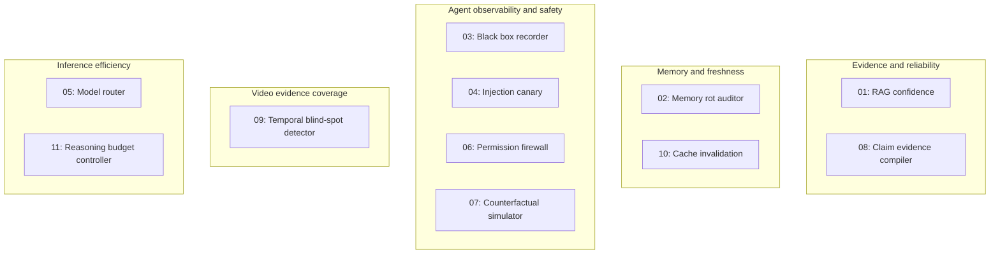

# Weekly POCs: AI Engineering Proof of Concepts

[](https://www.python.org/)
[](LICENSE)

Eleven experiments in AI reliability, agent safety, evidence verification, multimodal analysis, and inference efficiency. Run them from your IDE or terminal; no frontend or web server is required.

POCs **01–05** are standalone scripts. POCs **06–11** use the shared `poc_lab` package and include standalone entry points, JSON scenarios, offline demos, and regression tests. These are experimental prototypes; supported behavior and limitations are documented in each POC's README.

## POC catalog

| # | POC | What it demonstrates | Main output |
|---|---|---|---|
| 01 | [Disagreement-Based RAG Confidence](01-rag-confidence/) | Compare answers from retrieved chunks to identify conflicting evidence | Confidence and abstention decision |
| 02 | [Long-Term Memory Rot Auditor](02-memory-auditor/) | Detect stale, duplicate, and contradictory stored memories | Memory audit and cleanup suggestions |
| 03 | [Agent Black Box Recorder](03-blackbox-recorder/) | Record, replay, and compare agent execution traces | Run logs and divergence reports |
| 04 | [Prompt Injection Canary](04-injection-canary/) | Test defenses against malicious instructions in external content | Canary detections and defense comparison |
| 05 | [Cost-Aware Model Router](05-model-router/) | Route requests between model tiers | Routing and cost comparison |
| 06 | [Agent Permission Drift Firewall](06-permission-firewall/) | Enforce approved tools, ticket IDs, write fields, and workflow call limits | Allow/block decisions with reasons |
| 07 | [Counterfactual Agent Simulator](07-counterfactual-simulator/) | Simulate account updates on an isolated SQLite snapshot and check invariants | Before/after state and risk report |
| 08 | [Claim-Level Evidence Compiler](08-evidence-compiler/) | Check individual claims against sources and validate quotation provenance | Evidence manifest and supported-only answer |
| 09 | [Temporal Blind-Spot Detector](09-temporal-blindspot/) | Select extra video frames around visual changes missed by uniform sampling | Selected frames, timestamps, optional captions |
| 10 | [Semantic Cache Invalidation Engine](10-semantic-cache/) | Track source dependencies and selectively remove stale cached answers | Cache hits and invalidation reports |
| 11 | [Adaptive Reasoning Budget Controller](11-reasoning-budget/) | Verify arithmetic answers and revise within call, output-token, and time limits | Verified answer, stop reason, usage trace |

## System overview



## Repository structure

```text
weekly_pocs/
├── 01-rag-confidence/             # rag_confidence.py
├── 02-memory-auditor/             # memory_auditor.py
├── 03-blackbox-recorder/          # blackbox.py and example run traces
├── 04-injection-canary/           # injection_canary.py
├── 05-model-router/               # model_router.py
├── 06-permission-firewall/        # README.md, run.py, sample.json
├── 07-counterfactual-simulator/   # README.md, run.py, sample.json
├── 08-evidence-compiler/          # README.md, run.py, sample.json
├── 09-temporal-blindspot/          # README.md, run.py, sample.json
├── 10-semantic-cache/             # README.md, run.py, sample.json
├── 11-reasoning-budget/           # README.md, run.py, sample.json
├── poc_lab/                      # Shared CLI, implementations, Groq adapter, evaluation
├── tests/                        # Regression tests and recorded synthetic results
├── .env.example                  # Credential/configuration template; actual .env stays local
├── requirements.txt              # Dependencies for POCs 01–05
├── requirements-lab.txt          # Dependencies for POCs 06–11 and tests
├── requirements-lab-lock.txt     # Versions captured during Windows/Python 3.12 validation
├── pytest.ini
└── LICENSE
```

## Setup

Use Python **3.11+** for the full collection. From PowerShell:

```powershell
git clone https://github.com/siddharthsavant27/weekly_pocs.git
cd weekly_pocs
python -m venv .venv
.venv\Scripts\Activate.ps1
python -m pip install -r requirements-lab.txt
```

On macOS/Linux, activate with `source .venv/bin/activate`. To run POCs 01–05 as well, install their dependencies:

```shell
python -m pip install -r requirements.txt
```

The new lab uses Python, Pydantic, SQLite, NumPy, OpenCV, pytest, and the Groq SDK. Its CLI uses Python's built-in argument parser. It does not require Docker, a database server, or downloaded embedding models.

## Run POCs 06–11 offline

Run these commands from the repository root. No API key is needed:

```shell
python -m poc_lab 06
python -m poc_lab 07
python -m poc_lab 08
python -m poc_lab 09
python -m poc_lab 10
python -m poc_lab 11
```

Each command loads the corresponding `sample.json` and prints a JSON report. Customize a scenario or save the report:

```shell
python -m poc_lab 06 --input 06-permission-firewall/sample.json --output reports/firewall.json
python -m poc_lab 10 --db cache.db --output reports/cache.json
python -m poc_lab 09 --help
```

You can also run a POC directly, including from an IDE:

```shell
python 10-semantic-cache/run.py
```

POC 09 generates a synthetic video sequence by default. To inspect a real video, supply a JSON input containing a `video` path plus optional `stride`, `budget`, and `threshold` settings. Relative video paths resolve from the working directory.

## Optional live Groq inference

POCs **08, 09, and 11** support `--live`. POCs 06, 07, and 10 operate locally on explicit scenarios.

Copy `.env.example` to `.env` and set:

```dotenv
GROQ_API_KEY=your_api_key_here
GROQ_MODEL=openai/gpt-oss-20b
# Required for live video captioning; choose a vision model available to your account.
GROQ_VISION_MODEL=your_available_vision_model
```

Then run:

```shell
python -m poc_lab 08 --live
python -m poc_lab 09 --live --model YOUR_VISION_MODEL
python -m poc_lab 11 --live --env-file "path/to/.env"
```

Live mode sends supplied text or selected video frames to Groq. Keep `.env` local; it is ignored by Git. Model access and rate limits depend on your account. The existing POCs have their own provider settings; see their READMEs and `.env.example`.

For POC 08, omit `claims` from the input and provide `answer` to enable live claim extraction. With `claims` supplied, live mode verifies those claims directly.

## Run POCs 01–05

From the repository root with credentials configured:

```shell
python 01-rag-confidence/rag_confidence.py "How many days do I have to get a refund?"
python 02-memory-auditor/memory_auditor.py
python 03-blackbox-recorder/blackbox.py run "What is the total cost of 3 laptops and 2 pens?"
python 04-injection-canary/injection_canary.py
python 05-model-router/model_router.py
```

See the individual READMEs for replay commands, provider configuration, and detailed examples.

## Tests and evaluation

```shell
python -m pytest -q
python -m poc_lab.evaluate
```

The initial Windows/Python 3.12 validation passed **22 tests**, covering all six new CLI demos, permission violations, simulation invariants, persistent cache invalidation, citation rejection, generated video decoding, and reasoning limits. These tests cover POCs 06–11; they do not establish regression coverage for the original five scripts.

[Recorded offline comparisons](tests/evaluation-results.json) demonstrate behavior on synthetic fixtures. For example, adaptive sampling selected five frames and recovered an event missed by three uniform samples. These fixtures are not a general accuracy benchmark.

Live evidence judgment and arithmetic verification passed with `openai/gpt-oss-20b`. The live vision smoke test encountered a Groq rate limit; local video processing and the captioning adapter were tested using generated video and a stub provider.

## Current scope and extensions

| POC | Current implementation | Extension opportunities |
|---|---|---|
| 06 | Explicit, deny-by-default ticket-tool policies and guarded dispatch | MCP transport and reviewed intent-to-policy generation |
| 07 | Disposable SQLite account simulation with declared invariants | Docker environments and additional action types |
| 08 | Exact-match offline baseline; lexical retrieval and Groq judgments in live mode | Learned retrieval, NLI models, and larger labeled evaluations |
| 09 | Full low-resolution frame scan, bounded extra selection, optional captions | Event classification and coverage calibration |
| 10 | SQLite dependencies and source hashes with lexical cosine retrieval | Learned semantic embeddings and source watchers |
| 11 | Arithmetic verifier with bounded answer revisions | Additional verifiers and aggregate token/dollar budgets |

The cache's default encoder is lexical, despite the project's semantic-cache research direction. The simulator checks only declared invariants, and the video detector uses visual change as a proxy for missing evidence. See each POC's README for full limitations.

## References and license

Groq integration references: [text chat](https://console.groq.com/docs/text-chat) and [vision](https://console.groq.com/docs/vision).

Licensed under the [MIT License](LICENSE).
